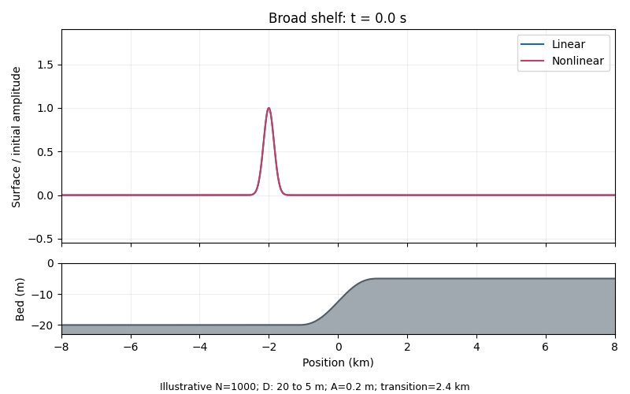
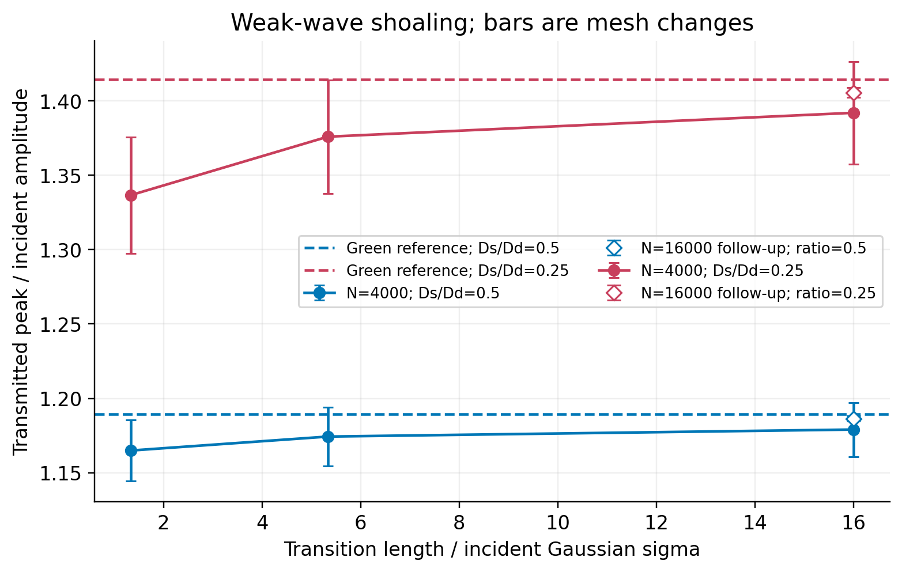
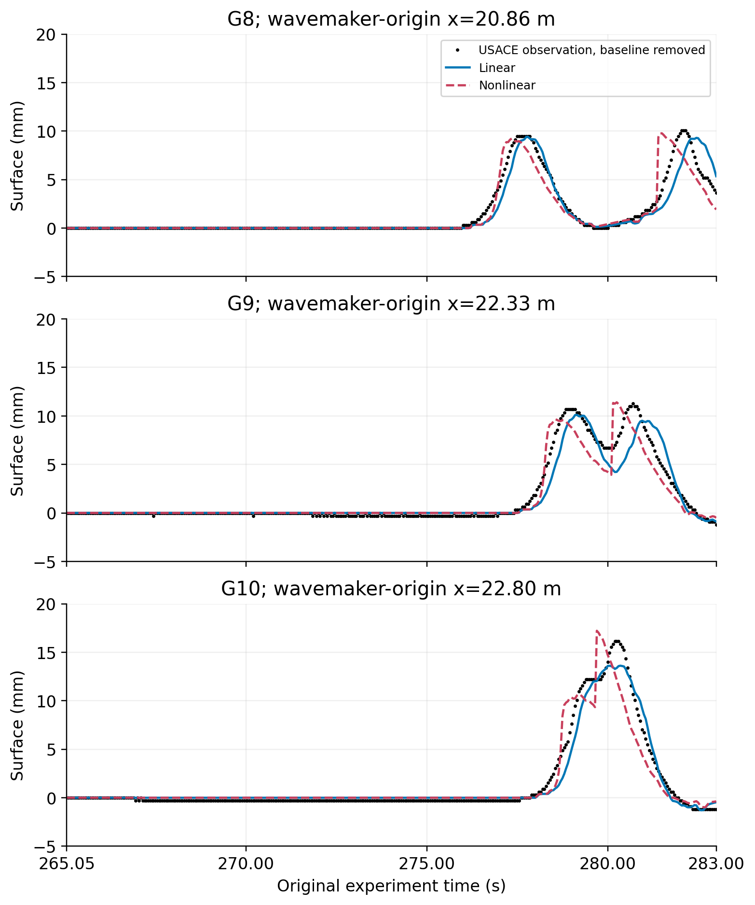

# Tsunami-inspired long-wave modeling

A completed, reproducible applied-mathematics project by JIajun FU. Version 1.0, October 2026.

**Research question:** When do linear and nonlinear shallow-water predictions diverge over a shelf, and how can physical differences be distinguished from discretization effects?

This repository contains a research-style project report, original Python solvers, analytical verification, mesh studies, a conditional NOAA laboratory comparison, executed notebook, scientific figures and an offline wave explorer. It is a computational project, not a published journal article or a coastal hazard forecast.

## Wave propagation preview



The animation shows computed wave propagation in a fully wet one-dimensional shelf domain. Display frames use 1,000 cells; quantitative conclusions use the finer grids recorded in the results tables.

[Download the offline interactive explorer](visualizations/wave_explorer.html) · [Read the final report](paper/main.pdf) · [Explore the executed notebook](notebooks/project_walkthrough.ipynb)

## Shoaling and laboratory comparison



The error bars show mesh changes, rather than statistical confidence intervals. Green’s law is a slow-transition reference.



NOAA Case A comparison uses the measured upstream input with no fitted time shift. This is a conditional laboratory comparison under the documented geometry and boundary assumptions.

## Main results

- All **35 numerical tests** pass, including lake at rest, manufactured solutions, boundary behavior, conservation and step coupling.
- At a 20-to-5 m aligned depth step, the independent linear reference gives reflection 1/3 and transmission 4/3. At 4,000 cells the linear solver has 0.368% relative L2 discrepancy; the restricted subcritical Bernoulli coupling has 0.792% discrepancy from the linear reference at low amplitude. The hydrostatic moving-wave control retains a much larger discrepancy, despite preserving rest.
- An **18-case shelf sweep** varies depth ratio, transition width and amplitude. Twelve cases pass the standard empirical resolution screen. Two selected weak-amplitude cases pass after refinement to 16,000 cells. Four weak-amplitude cases remain unresolved at the standard grids; the report does not claim their differences are physically resolved.
- Using NOAA Case A G4 as incoming input, six downstream gauges are compared without parameter fitting or time alignment. Normalized RMSE is 4.06–9.64% for the linear model and 3.96–10.17% for the nonlinear model. The geometry and metadata decisions make this a **conditional comparison**; nonlinear predictions do not improve every gauge.

## Start here

1. Read `paper/main.pdf` and `docs/FINAL_SUMMARY_CN.md`.
2. Open `visualizations/wave_explorer.html` directly in a browser. It works offline.
3. Inspect the executed `notebooks/project_walkthrough.ipynb` or its HTML export.
4. Inspect `results/*.csv` and the final figures. Historical V0.1–V0.3 files are retained and clearly named.

## Install and run

Python 3.11 is recommended. The delivered calculations used Python 3.11, NumPy 2.3.5 and Matplotlib 3.10.8. Create a virtual environment if desired.

```bash
python -m pip install -r requirements.txt
python scripts/run_verification.py
python scripts/run_final_studies.py --section step
```

Full reproduction, including the original laboratory data download, the 18-case sweep, fine refinements and visualization:

```bash
python scripts/reproduce_all.py
```

This performs several minutes of computation, depending on hardware. Internet access is required for the official laboratory archive; its SHA-256 is pinned. No third-party raw measurements are distributed in this repository.

Synthetic-only reproduction (no external data):

```bash
python scripts/reproduce_all.py --synthetic-only
```

Individual stages:

```bash
python scripts/run_experiments.py
python scripts/run_v02.py
python scripts/run_v03.py
python scripts/run_final_studies.py --section shelf
python scripts/run_final_studies.py --section lab
python scripts/run_weak_refinement.py --ratio 0.5
python scripts/run_weak_refinement.py --ratio 0.25
python scripts/build_final_figures.py
python scripts/build_visualizations.py
```

For editable notebooks:

```bash
python -m pip install -r requirements-notebooks.txt
jupyter lab notebooks/project_walkthrough.ipynb
```

The delivered notebook's five code cells were executed in order in one shared Python namespace. Its execution metadata documents the in-process build method. Standard Jupyter execution on a local computer is supported.

Compile the report with an installed TeX distribution:

```bash
cd paper
pdflatex -interaction=nonstopmode -halt-on-error main.tex
pdflatex -interaction=nonstopmode -halt-on-error main.tex
```

Figures and generated tables are already bundled. Regenerating the laboratory figures requires fetching the raw archive first.

## Repository map

| Path | Contents |
|---|---|
| `src/tsunami/` | First-order baseline, flat-bed solvers, variable-bed solvers, restricted stationary step coupling |
| `tests/` | 35 tests; no laboratory download needed |
| `configs/` | Fixed study parameters, with units |
| `scripts/` | Verification, experiments, data fetch, plots and visualization generation |
| `results/` | Final CSV/JSON metrics, NPZ predictions, execution records |
| `figures/final_*` | Report figures generated from recorded results |
| `paper/` | Final report PDF, LaTeX source and generated tables; earlier methods drafts |
| `notebooks/` | Executed walkthrough and HTML export |
| `visualizations/` | Offline explorer, template, GIF and demonstration metadata |
| `data/` | Source provenance and download policy; downloaded archive is excluded from releases |
| `docs/` | Chinese summary, reproducibility guide, derivations and resume bullets |
| `v0.*_results/`, `v0.*_figures/` | Historical stages; not the final scientific sweep |

## Scope and attribution

One-dimensional, fully wet, static-bathymetry, nondispersive shallow-water models are used. Wetting/drying, inundation, frictional calibration, physical breaking closures and historical-event validation are outside the completed study. Positivity was monitored in the runs; no universal positivity guarantee is claimed. The aligned-step Bernoulli interface assumes a lossless fully wet subcritical branch; it is not a general resonant or transcritical Riemann solver.

The MIT license covers original code and project text, not source publications or third-party raw data. Sources and their methods are cited in the report. AI assistance was used for code drafting, documentation and analysis organization, as disclosed in the report. Inspect and reproduce the project before describing or defending it in an application or interview.

See `CITATION.cff`, `docs/REPRODUCIBILITY.md` and `data/README.md` for citation, metrics and data decisions.
